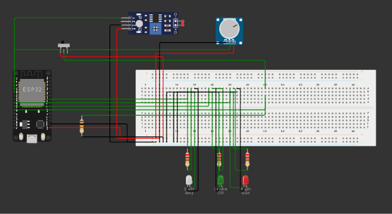
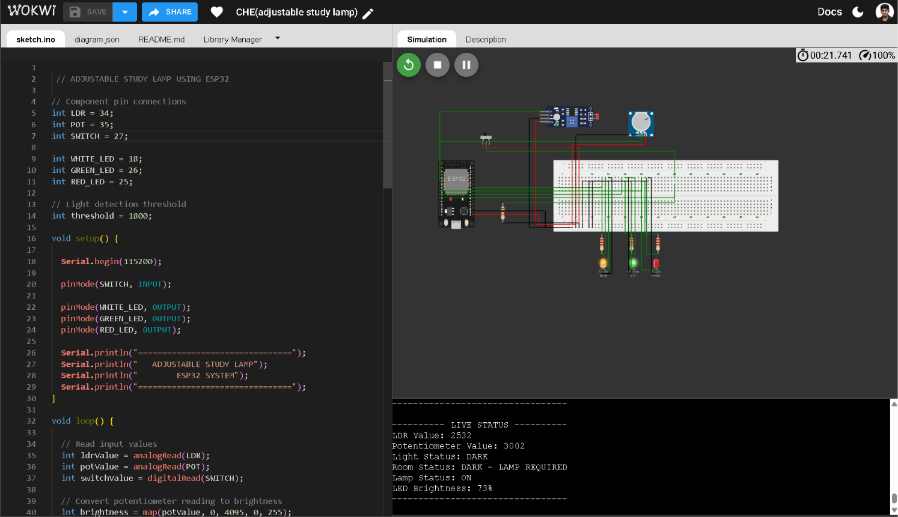
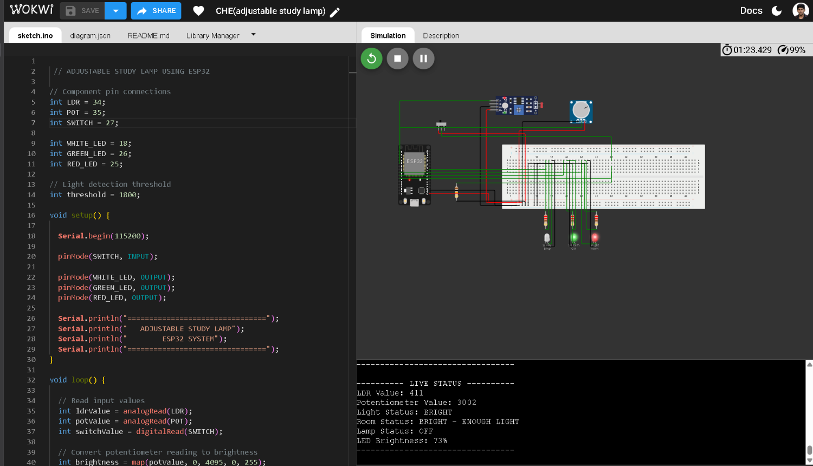

# Adjustable Study Lamp (ESP32 + Wokwi)

An automatic study-lamp prototype built with an ESP32, an LDR light sensor, a potentiometer, a master slide switch and three LEDs. The circuit is designed for simulation in https://wokwi.com/projects/480046299382650881.

## Features

- **Automatic light detection:** the LDR measures ambient light. The lamp turns on when the room becomes dark and turns off when the room is bright.
- **Adjustable brightness:** the potentiometer controls the lamp LED brightness using PWM.
- **Master switch:** the slide switch enables or disables the complete system.
- **Status indicators:** green means the system is enabled; red means the room is bright enough and the lamp is not required.
- **Serial monitoring:** sensor readings, brightness level and system state are printed at 115200 baud.
- **Hysteresis:** separate dark/bright thresholds reduce rapid switching when the light level is near the cutoff.

## Components

| Component | Quantity | Purpose |
|---|---:|---|
| ESP32 DevKit v1 | 1 | Main controller |
| Breadboard | 1 | Circuit prototyping |
| LDR / photoresistor sensor module | 1 | Ambient-light measurement |
| 10 kΩ resistor | 1 | Pull-down for the master-switch input |
| 10 kΩ potentiometer | 1 | Brightness adjustment |
| SPDT slide switch | 1 | Master ON/OFF control |
| White LED | 1 | Main lamp output |
| Green LED | 1 | System-enabled indicator |
| Red LED | 1 | Bright-room indicator |
| 220 Ω resistors | 3 | LED current limiting |
| Jumper wires | As required | Connections |
| 5 V USB supply | 1 | Powers the ESP32 development board |
| 3.3 V output from ESP32 | 1 | Safe supply for the LDR module and potentiometer |

**Wokwi note:** The Wokwi photoresistor *sensor module* includes its own 10 kΩ sensing resistor. The separate 10 kΩ resistor in this diagram is used as the slide-switch input's pull-down resistor.

## Pin connections

| ESP32 GPIO / pin | Connected component | Function |
|---|---|---|
| GPIO34 (D34) | LDR AO | Ambient-light analog input |
| GPIO35 (D35) | Potentiometer SIG | Brightness analog input |
| GPIO27 (D27) | Slide switch common | Master switch input |
| GPIO18 (D18) | White LED through 220 Ω | PWM lamp output |
| GPIO26 (D26) | Green LED through 220 Ω | System-enabled indicator |
| GPIO25 (D25) | Red LED through 220 Ω | Bright-room indicator |
| 3V3 | LDR VCC, potentiometer VCC, switch ON contact | 3.3 V supply |
| GND | LDR GND, potentiometer GND, LED cathodes, 10 kΩ pull-down | Common ground |

### Switch wiring

- Slide-switch pin 1 goes to 3.3 V.
- Slide-switch pin 2 (common) goes to GPIO27.
- GPIO27 is connected to GND through the 10 kΩ pull-down resistor.
- Leave slide-switch pin 3 unconnected.

### LED wiring

Each LED has its own 220 Ω series resistor. The GPIO connects through the resistor to the LED anode (A); the LED cathode (C) goes to GND.

## How the program works

1. Read the LDR and potentiometer using `analogRead()`.
2. Read the master switch on GPIO27.
3. Use two LDR thresholds to decide whether the room is dark or bright.
4. Map the potentiometer reading to a PWM value from 0 to 255.
5. Turn the white LED on only when the switch is enabled and the room is dark.
6. Update the green and red status LEDs and print the state to Serial Monitor.

The initial thresholds in `sketch.ino` are starting values for the simulated sensor. They can be calibrated for a real LDR module and its voltage-divider arrangement. If your lab kit has red/yellow/green LEDs rather than a white LED, use the yellow LED as the lamp output and keep the red and green indicators.

## Run it in Wokwi

1. Open [Wokwi](https://wokwi.com/) and create an ESP32 project.
2. Open the `diagram.json` file in the project and replace its contents with this repository's `diagram.json`.
3. Open `sketch.ino` and replace the starter code with this repository's `sketch.ino`.
4. Start the simulation.
5. Move the slide switch to ON. The default LDR setting is 50 lux (dim), and the potentiometer starts above zero, so the lamp should light.
6. Click the photoresistor sensor and change its `lux` attribute: try around 50 lux for a dim room and 500–1000 lux for a brighter room.
7. Turn the potentiometer to change the lamp brightness.
8. Move the slide switch to OFF to disable all outputs.
9. Open the Serial Monitor at 115200 baud to observe the readings and state.

## Test cases

| Test | Switch | Ambient light | Potentiometer | Expected result |
|---|---|---|---|---|
| 1 | ON | Dark | Mid-range | White lamp LED on at medium brightness; green LED on; red LED off |
| 2 | ON | Dark | High | White lamp LED on at higher brightness; green LED on |
| 3 | ON | Bright | Any | White lamp LED off; green and red LEDs on |
| 4 | OFF | Dark | Any | All LEDs off |
| 5 | ON | Dark | Minimum | Lamp LED off or very dim; green LED on |

## Safety and real-hardware notes

- Power the ESP32 board from its USB 5 V input. Power the LDR module and potentiometer from the ESP32 **3.3 V** pin, not 5 V, so their analog outputs stay within the ESP32 input range.
- Keep a 220 Ω resistor in series with each standard indicator LED.
- This is a low-voltage prototype. Do not connect a mains-powered lamp directly to an ESP32 GPIO. A real high-power lamp needs a properly rated, isolated driver and adult supervision.
- Wokwi is a simulation; verify the actual sensor polarity and ADC thresholds before building a physical version.

## Future improvements

- Add a manual/automatic mode selector.
- Add an OLED to display ambient-light and brightness readings.
- Add a calibration menu for the LDR threshold.
- Design a 3D-printed lamp enclosure after the circuit is tested.

## Repository structure

```text
adjustable-study-lamp-esp32/
├── diagram.json
├── sketch.ino
├── README.md
└── .gitignore
```

## Skills demonstrated

ESP32 GPIO, ADC analog input, PWM LED brightness control, sensor-based automation, input pull-downs, circuit prototyping, Arduino C++, Wokwi simulation and Git/GitHub documentation.

## Project Demonstration

### Circuit Diagram



### Simulation

The project was designed and tested using Wokwi.

**Wokwi Simulation:** [Open Live Simulation](PASTE_YOUR_WOKWI_LINK_HERE)

### Serial Monitor Output

The ESP32 displays real-time sensor readings and system information.

**Dark Room:** The LDR detects low ambient light and the white LED operates according to the potentiometer setting.



**Bright Room:** The system detects sufficient ambient light and switches off the white lamp LED.



## Key Learning Outcomes

- Understanding ESP32 GPIO and ADC pins.
- Reading analog sensor values.
- Using potentiometers for manual control.
- Implementing PWM-based LED brightness control.
- Developing automatic control logic using conditional statements.
- Monitoring hardware behaviour through Serial communication.


## Live Simulation

The project is designed and simulated using Wokwi.

**Try the project here:**

[Open Adjustable Study Lamp Simulation](https://wokwi.com/projects/480046299382650881)

## Project Demonstration

### Circuit Diagram


### Key Features

- Automatic ambient light detection using LDR.
- Manual brightness adjustment using a potentiometer.
- PWM-based LED brightness control.
- Master ON/OFF switch.
- Real-time sensor monitoring through Serial Monitor.
